# EyeControl — Eye Gesture Phone Control for Android

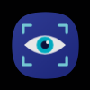

EyeControl lets you control an Android phone hands-free with eye and head gestures. The front camera feeds frames to on-device ML Kit face detection. A gesture detector turns eye-open probabilities, eye contours and head pose into named gestures. An Accessibility Service then performs the action you mapped to each gesture: scroll, tap, back, home, volume, media keys and so on.

All processing happens on the device. The app does not request the `INTERNET` permission.

---

## Table of contents

1. [Features](#features)
2. [Screens](#screens)
3. [Architecture](#architecture)
4. [Detection pipeline](#detection-pipeline)
5. [Database and preferences](#database-and-preferences)
6. [Design patterns](#design-patterns)
7. [Services, permissions and manifest](#services-permissions-and-manifest)
8. [Tech stack](#tech-stack)
9. [Build and run](#build-and-run)
10. [Known limitations](#known-limitations)

---

## Features

- **23 eye gestures.** Blinks, winks, gaze directions, wide-open/half-open eyes, squint, slow blink, alternate blink, rapid blink and more (`domain/model/EyeGesture.kt`). The enum has 27 entries; 4 are marked `isSupported = false` and hidden because the detector does not emit them yet.
- **21 phone actions.** Scroll, swipe, tap, double tap, long press, zoom, back, home, recents, notifications, lock screen, volume and media keys (`domain/model/AppAction.kt`).
- **Configurable gesture mapping.** Each gesture can be mapped to an action, enabled or disabled per gesture, and reset to defaults.
- **Face Pointer (mouse mode).** Head movement moves an on-screen cursor, and a TAP-mapped gesture clicks at the cursor position.
- **Live preview.** A camera preview with live eye-open probabilities, EAR values, face/gaze state and a history of detected gestures.
- **Calibration.** A guided, measured wizard that derives personal blink and head-movement thresholds, plus manual sliders.
- **Feedback.** Optional haptic and spoken (TextToSpeech) confirmation of each action, and an optional on-screen indicator.
- **Gesture history.** Every dispatched action is logged to Room and can be reviewed or cleared.
- **Background operation.** A camera-type foreground service keeps detection running outside the app. After a reboot, a notification offers to resume tracking (Android 15+ does not allow a camera service to start from boot).
- **Material 3 theme.** Dynamic color on Android 12+ and a dark mode toggle.

---

## Screens

All screenshots were taken on a Samsung Galaxy A53 (1080x2400, Android 16).

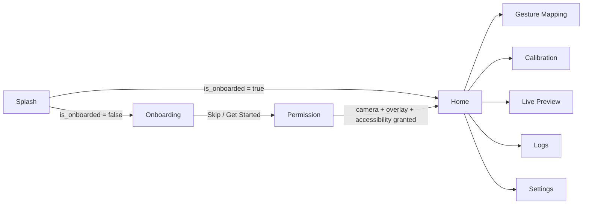

Routes are declared in `ui/navigation/Screen.kt` and wired in `ui/navigation/AppNavigation.kt` (Navigation Compose `NavHost`, start destination `splash`). Splash and Onboarding are removed from the back stack when you leave them.

### 1. Splash

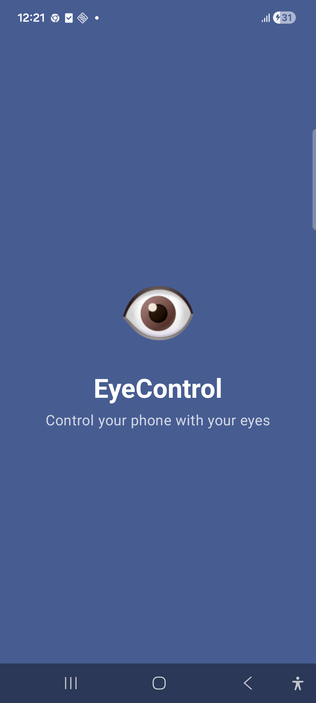

- A pulsing eye icon, the app name and a tagline on the primary color.
- After 2 seconds, `SplashViewModel` reads `is_onboarded` from DataStore and routes to Onboarding or Home.
- **Files:** `ui/screens/splash/SplashScreen.kt`, `SplashViewModel.kt`.

### 2. Onboarding

| Page 1 | Page 2 | Page 3 | Page 4 |
|---|---|---|---|
| 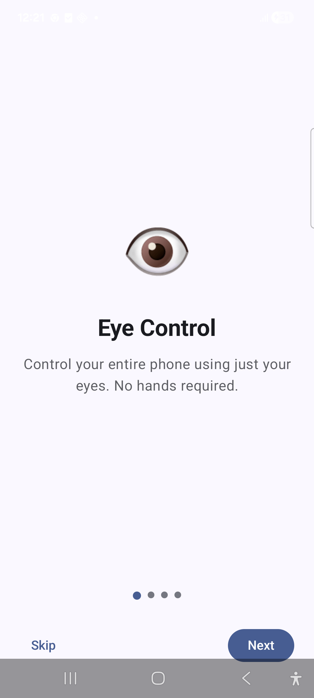 | 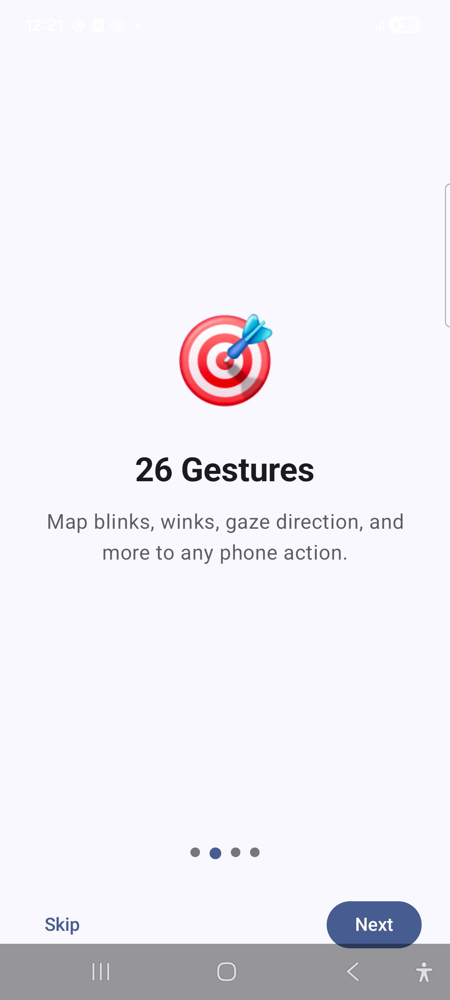 | 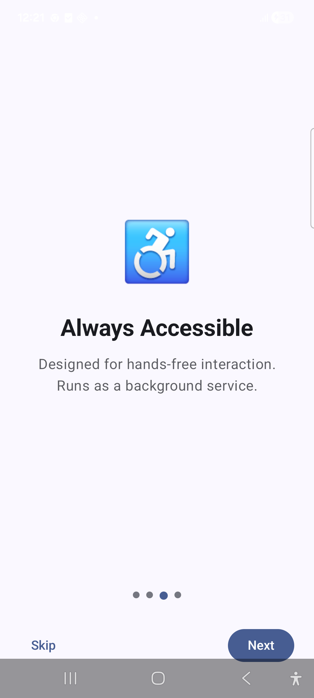 | 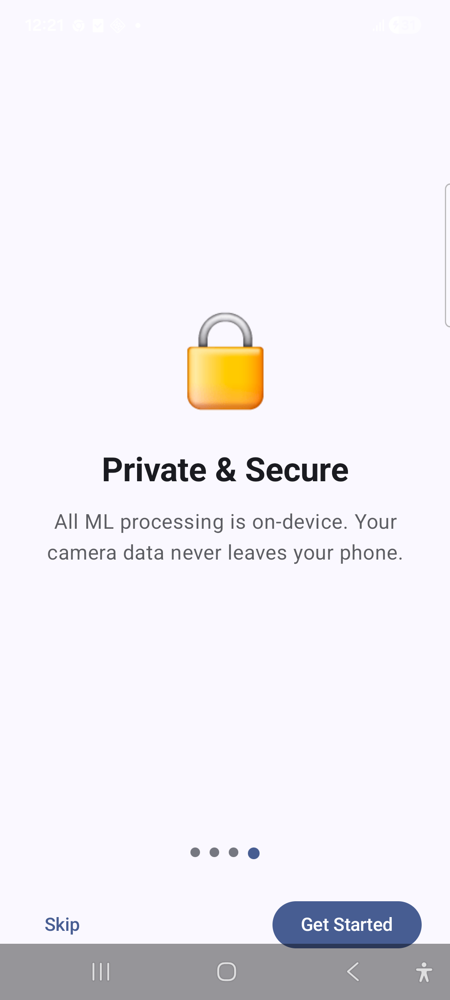 |

- Four introduction pages with page indicators, **Skip** and **Next / Get Started**.
- Finishing onboarding calls `OnboardingViewModel.completeOnboarding()`. This seeds the default gesture mappings in Room (`GestureMappingRepository.insertDefaultMappings()`) and sets `is_onboarded = true`.
- **Files:** `ui/screens/onboarding/OnboardingScreen.kt`, `OnboardingViewModel.kt`.

### 3. Permission setup

| Nothing granted | Camera and overlay granted |
|---|---|
| 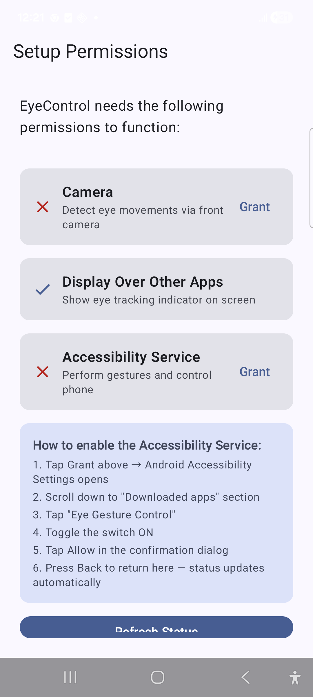 | 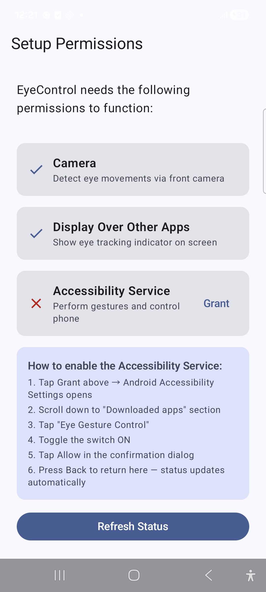 |

- Cards, each showing whether its permission is granted and a **Grant** button:
  - **Camera:** runtime permission dialog.
  - **Display over other apps:** opens `ACTION_MANAGE_OVERLAY_PERMISSION`.
  - **Accessibility Service:** opens `ACTION_ACCESSIBILITY_SETTINGS`, with step-by-step instructions while it is off.
  - **Notifications (optional, Android 13+):** runtime `POST_NOTIFICATIONS` dialog. Not required to continue.
- Status is re-checked every time the screen resumes and with **Refresh Status**. Once the three required permissions are granted, the app moves to Home automatically.
- State: `PermissionState(cameraGranted, overlayGranted, accessibilityEnabled, notificationsGranted)` with a derived `allGranted`.
- The screenshots predate the Notifications card.
- **Files:** `ui/screens/permission/PermissionScreen.kt`, `PermissionViewModel.kt`.

### 4. Home

| Service off | Service on |
|---|---|
| 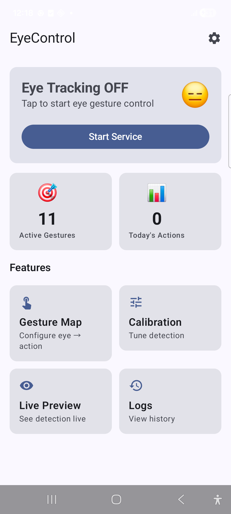 | 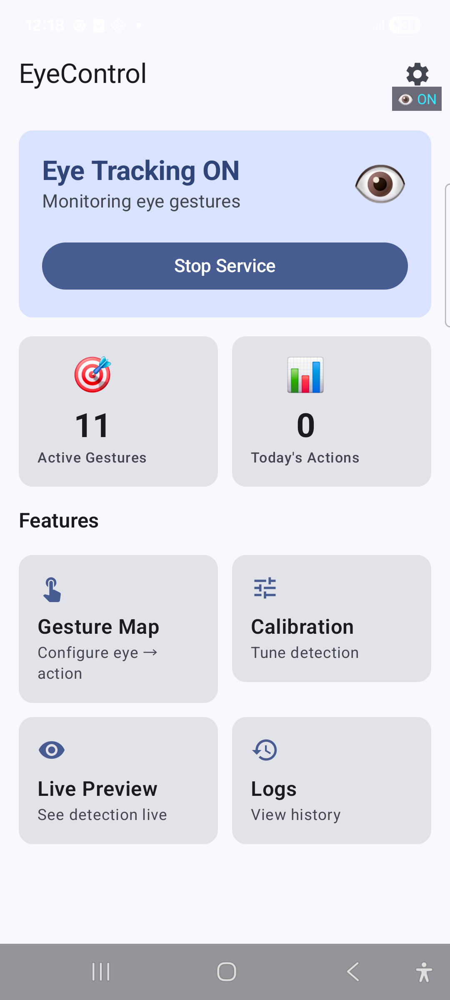 |

- **Service card.** Starts or stops `EyeTrackingForegroundService` and saves `is_service_enabled`. On Android 13+ the first start asks for notification permission. If camera permission is missing, the service is not started and an error is shown. When the service is running and **Show Overlay Indicator** is on, the `OverlayManager` indicator ("ON", top right) is drawn over other apps.
- **Stat cards.** Enabled mappings for supported gestures, and the number of actions logged since local midnight (live from Room).
- **Feature grid.** Gesture Map, Calibration, Live Preview and Logs. Settings is the gear icon in the top bar.
- State: `HomeState(isServiceEnabled, activeMappingsCount, todayGesturesCount)`, built with `combine` over DataStore and Room flows.
- **Files:** `ui/screens/home/HomeScreen.kt`, `HomeViewModel.kt`.

### 5. Gesture Mapping

| Mapping list | Action picker | Reset confirmation |
|---|---|---|
| 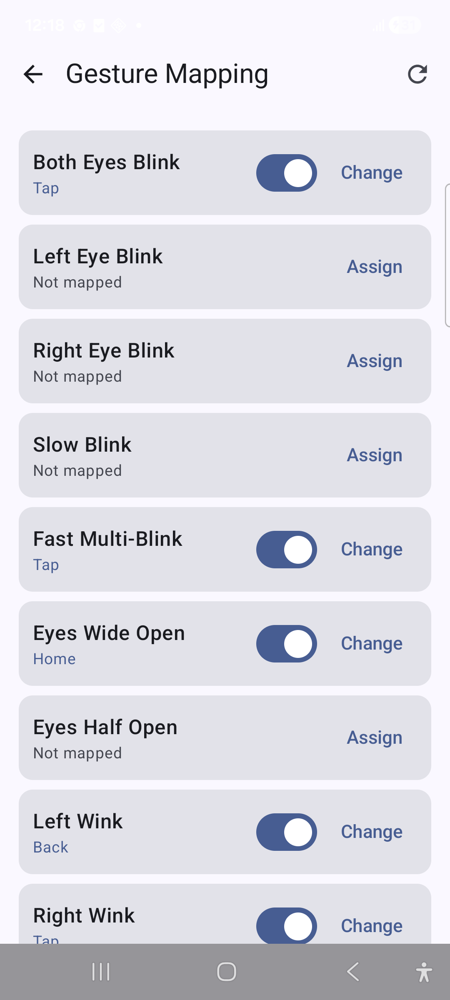 | 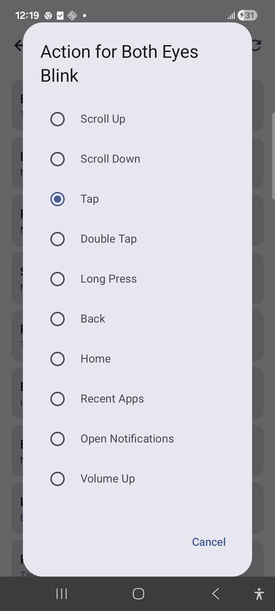 | 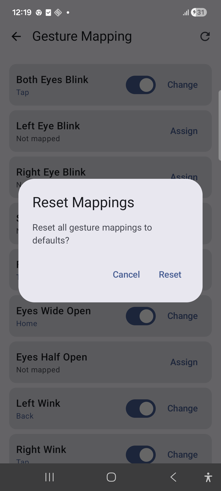 |

- Lists the 23 supported gestures (`EyeGesture.supported`). Mapped gestures show their action, an enable switch and **Change**. Unmapped gestures show **Assign**.
- **Change/Assign** opens a radio list of all actions. The refresh icon resets all mappings to the defaults in a single Room transaction.
- ViewModel API: `mappings: StateFlow<List<GestureMapping>>`, `updateMapping()`, `toggleMapping()`, `resetToDefaults()`.
- **Files:** `ui/screens/gesturemapping/GestureMappingScreen.kt`, `GestureMappingViewModel.kt`.

### 6. Calibration

| Idle | Step in progress |
|---|---|
| 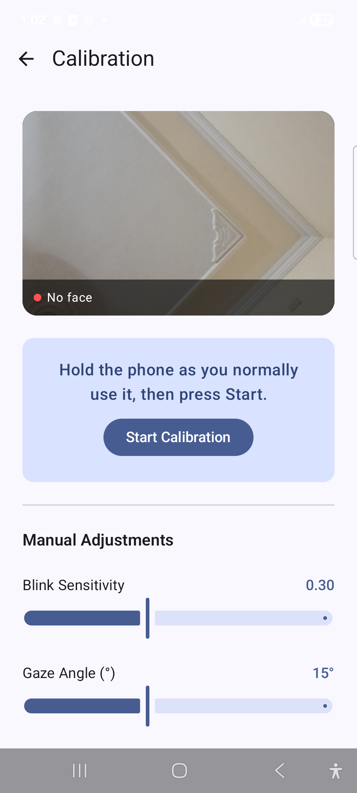 | 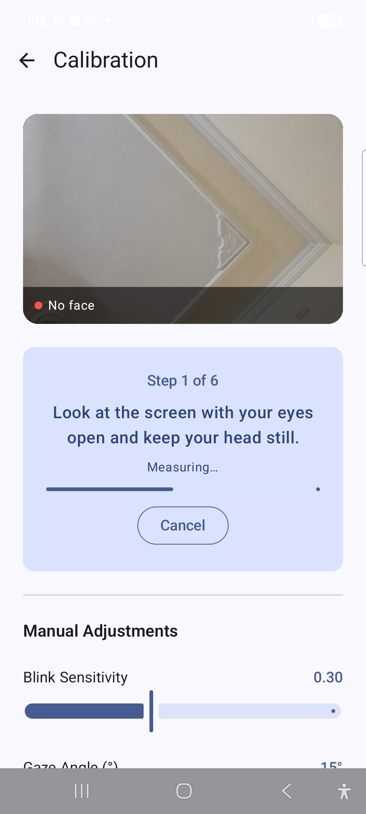 |

A measured, six-step wizard driven by the `CalibrationStep` enum:

| Step | You do | Measured |
|---|---|---|
| `EYES_OPEN` | Look at the screen, head still | Open-eye probability, neutral yaw/pitch |
| `EYES_CLOSED` | Close your eyes until the phone vibrates | Closed-eye probability |
| `TURN_LEFT` / `TURN_RIGHT` | Turn your head as far as is comfortable | Yaw range |
| `TILT_UP` / `TILT_DOWN` | Tilt your head as far as is comfortable | Pitch range |

- Each step has a short "Get ready" phase, then samples face-detected frames for 2.5–3 s. The phone vibrates at the end of each step.
- Calibration uses its own `FaceAnalyzer` instance, so frames never reach `EyeGestureDetector` and no mapped actions fire while you close your eyes or turn your head.
- `CalibrationCalculator` (`detection/CalibrationCalculator.kt`) derives the thresholds:
  - **Blink threshold:** 40% of the way from closed-eye to open-eye probability, clamped to 0.1–0.6.
  - **Head turn/tilt:** 60% of your comfortable range, measured from your neutral pose. Offsets are clamped to 5–30° for yaw and 4–25° for pitch.
  - Single noisy frames are ignored by using the 90th percentile.
- The run fails without saving if:
  - fewer than 5 face frames are seen in a step;
  - closed eyes are not clearly different from open eyes;
  - the head moves less than 6° in either direction.
- On success, the new values are saved to DataStore, and a before → after summary is shown.
- **Manual Adjustments** sliders write straight to DataStore:

| Slider | Range | What it writes |
|---|---|---|
| Blink Sensitivity | 0.1–0.6 | `blink_threshold` |
| Gaze Angle | 5–30° | left/right = ±value, up/down = ±0.7×value |
| Cooldown | 200–2000 ms | `global_cooldown_ms` |

- **Files:** `ui/screens/calibration/CalibrationScreen.kt`, `CalibrationViewModel.kt`.

### 7. Live Preview ("Eye Training")

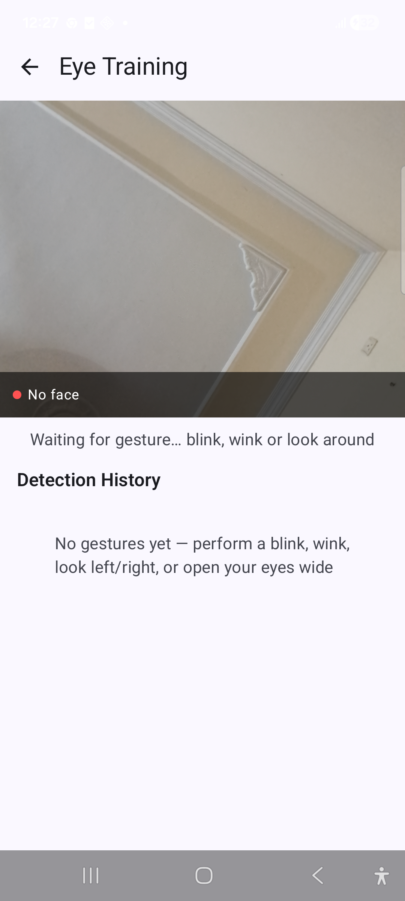

- A front-camera preview with an overlay showing:
  - face detected / no face
  - gaze direction
  - left/right eye-open probability bars and EAR values
- A banner shows the latest gesture and its confidence, then auto-hides after 3 s.
- **Detection History** keeps the last 20 gestures and can be cleared.
- The ViewModel binds `Preview` + `ImageAnalysis` through `FrontCameraSession`, which only unbinds its own use cases. While the preview is open, CameraX gives the camera to this screen; the foreground service gets it back when you leave. It observes `EyeGestureDetector.gestureFlow` and `faceDataFlow`.
- **Files:** `ui/screens/preview/LivePreviewScreen.kt`, `LivePreviewViewModel.kt`.

### 8. Settings

| Top | Scrolled (detection) |
|---|---|
| 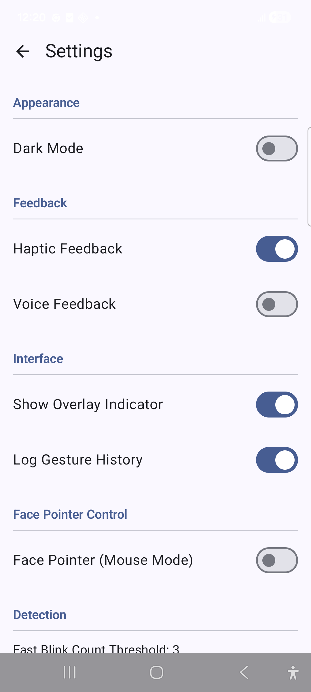 | 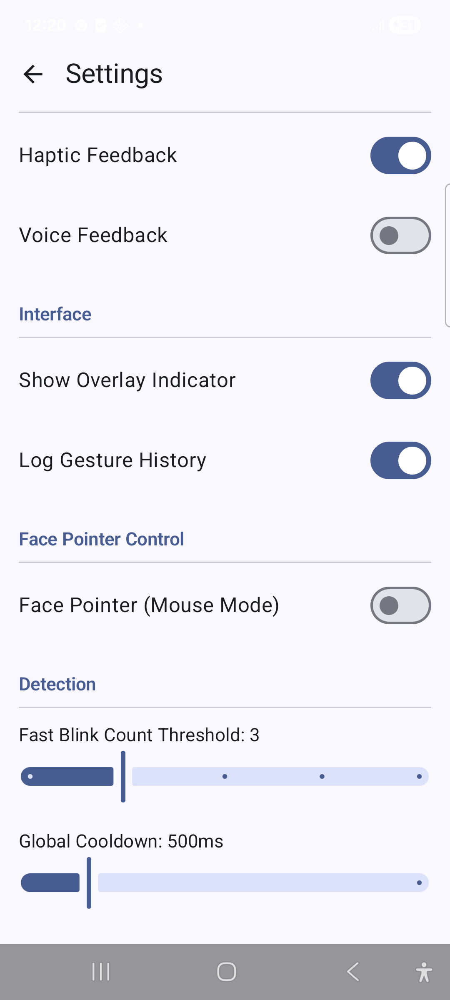 |

Sections and controls:
- **Appearance:** Dark Mode.
- **Feedback:** Haptic Feedback (50 ms vibration per action), Voice Feedback (speaks the action name through TextToSpeech; the engine is only held while enabled).
- **Interface:** Show Overlay Indicator (applied live by the running service), Log Gesture History.
- **Face Pointer Control:** Face Pointer (Mouse Mode). When it is on, the Pointer Speed (0.5–4.0x) and Sensitivity (1–8) sliders appear.
- **Detection:** Fast Blink Count Threshold (2–6), Global Cooldown (200–2000 ms).

All values are persisted in DataStore and exposed as `StateFlow<DetectionSettings>`. The foreground service and the accessibility service both collect the settings flow, so changes apply without restarting tracking.

**Files:** `ui/screens/settings/SettingsScreen.kt`, `SettingsViewModel.kt`.

### 9. Logs ("Gesture History")

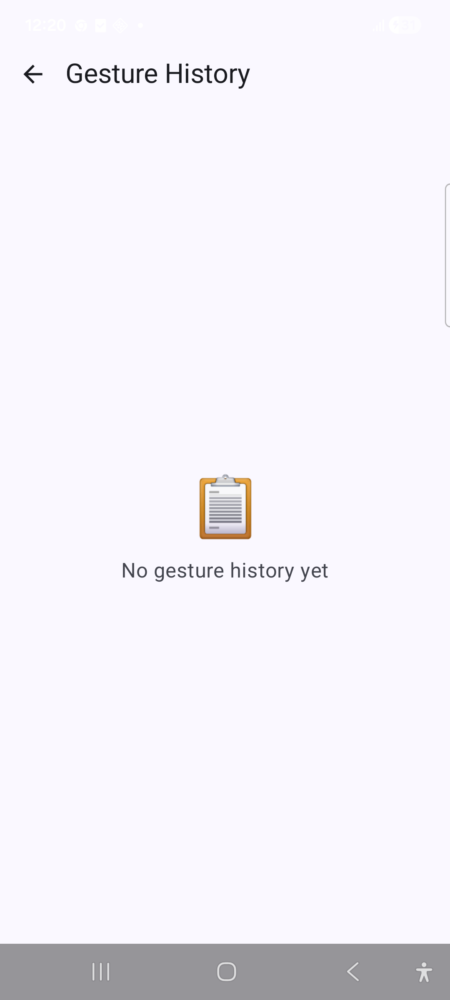

- The 200 most recent log rows, newest first, each showing gesture → action, time (HH:mm:ss) and confidence.
- The delete icon (shown only when logs exist) opens a **Clear Logs** confirmation.
- The screenshot shows the empty state.
- **Files:** `ui/screens/logs/LogsScreen.kt`, `LogsViewModel.kt`.

---

## Architecture

The app uses MVVM with a repository-based data layer and Hilt for dependency injection. UI is 100% Jetpack Compose (Material 3).

```
com.app.eyesmotiondetection
├── EyesMotionApp.kt            @HiltAndroidApp
├── MainActivity.kt             Single activity, edge-to-edge, hosts AppNavigation
├── domain/model                Pure Kotlin models
│   ├── EyeGesture              27 gestures (enum), 23 supported
│   ├── AppAction               21 actions (enum)
│   ├── GestureMapping, GestureLog, DetectionSettings
├── data
│   ├── database                Room: AppDatabase, entities, DAOs, Migrations
│   ├── datastore               AppPreferences (Preferences DataStore)
│   └── repository              GestureMappingRepository, GestureLogRepository
├── detection                   Camera → gesture logic
│   ├── FaceAnalyzer            CameraX ImageAnalysis.Analyzer + ML Kit → FaceData callback
│   ├── FrontCameraSession      Binds/unbinds only its own CameraX use cases
│   ├── CalibrationCalculator   Pure threshold derivation from calibration samples
│   ├── EyeMetricsCalculator    EAR, gaze, probabilities → FaceData
│   ├── EyeGestureDetector      Frame-to-frame gesture recognition
│   ├── GestureAnalyzer         Mapping lookup, cooldown, logging → ActionEvent
│   └── model                   FaceData, GestureResult
├── service
│   ├── EyeTrackingForegroundService   LifecycleService, owns the camera
│   ├── EyeTrackingAccessibilityService Performs actions
│   ├── ActionDispatcher        AppAction → global actions / gestures / media keys
│   ├── FacePointerManager      Head-controlled cursor overlay
│   ├── OverlayManager          "ON" indicator overlay
│   ├── VoiceFeedback           TextToSpeech wrapper
│   ├── ResumeTrackingNotification  "Tap to resume" after boot / blocked restart
│   ├── GestureEventBus         Service → accessibility (SharedFlow)
│   └── PointerClickBus         Pointer clicks → accessibility (SharedFlow)
├── receiver/BootReceiver       Posts the resume notification after boot
├── di                          DatabaseModule (Room, DAOs), DetectionModule (FaceAnalyzer)
├── util/Vibration.kt           One-shot vibration helper
└── ui
    ├── navigation              Screen routes, NavHost
    ├── screens/<feature>       <Feature>Screen.kt + <Feature>ViewModel.kt
    └── theme                   Color, Type, Theme (dynamic color)
```

---

## Detection pipeline

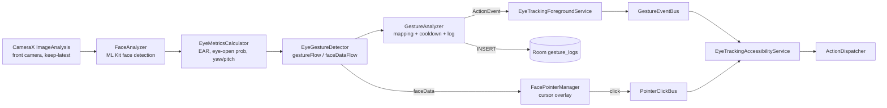

**FaceAnalyzer** (`detection/FaceAnalyzer.kt`) configures ML Kit as follows:
- FAST performance mode
- all landmarks, contours and classifications
- minimum face size 0.15
- tracking enabled

It processes the first face found and hands the result to a callback on a single-lane dispatcher (`Dispatchers.Default.limitedParallelism(1)`). Frames are therefore processed in order and never concurrently, which `EyeGestureDetector` needs because it keeps unsynchronized frame-to-frame state. The app-wide instance (`di/DetectionModule.kt`) feeds `EyeGestureDetector`; Calibration creates its own instance.

**EyeMetricsCalculator** (`detection/EyeMetricsCalculator.kt`) computes the Eye Aspect Ratio from the 16-point ML Kit eye contour:

```
EAR = (|p3 − p13| + |p5 − p11|) / (2 · |p0 − p8|)
```

Blink detection uses ML Kit's `eyeOpenProbability`. EAR is used for squint detection.

**EyeGestureDetector** (`detection/EyeGestureDetector.kt`) compares consecutive frames and tracks timing windows:

| Gesture or setting | Rule |
|---|---|
| Eye closed | probability below `blink_threshold` (default 0.3) |
| Full blink | average below 0.15 |
| Slow blink | 300–1500 ms |
| Double wink | two winks within 400 ms |
| Rapid nervous blink | 6+ blinks in 2 s |
| Alternate blink | 4 alternations within 3.5 s |
| Eyes shaking | 3+ yaw sign flips (±8°) in 8 frames |
| Gaze left/right | yaw beyond ±15° (default, or calibrated) |
| Gaze up/down | pitch beyond ±10° (default, or calibrated) |
| Front-camera mirroring | gaze directions are swapped to correct for it |
| Global cooldown | applied in `emit()` (default 500 ms) |

**GestureAnalyzer** (`detection/GestureAnalyzer.kt`):
- Looks up the gesture's mapping and drops it if unmapped or disabled.
- Applies a per-mapping cooldown (`cooldownMs`, default 1000 ms).
- Emits an `ActionEvent`.
- Writes a `gesture_logs` row when logging is enabled.

**ActionDispatcher** (`service/ActionDispatcher.kt`):

| AppAction | Implementation |
|---|---|
| BACK, HOME, RECENT_APPS, OPEN_NOTIFICATIONS, LOCK_SCREEN | `AccessibilityService.performGlobalAction(GLOBAL_ACTION_*)` |
| SCROLL_UP/DOWN, SWIPE_LEFT/RIGHT, TAP, DOUBLE_TAP, LONG_PRESS, ZOOM_IN/OUT | `dispatchGesture()` with `GestureDescription` strokes |
| VOLUME_UP/DOWN | `AudioManager.adjustStreamVolume` |
| PLAY_PAUSE_MEDIA, NEXT_SONG, PREVIOUS_SONG | `AudioManager.dispatchMediaKeyEvent` |
| OPEN_APP, NONE | No-op |

Before each action, `ActionDispatcher` vibrates if Haptic Feedback is on, and speaks the action name if Voice Feedback is on.

---

## Database and preferences

### Room — `eye_tracking_db` (version 2)

Defined in `data/database/AppDatabase.kt` and provided as a singleton by `di/DatabaseModule.kt`. The schema is exported to `app/schemas/` (`exportSchema = true`, KSP arg `room.schemaLocation`), so future migrations can be tested against it.

**Migrations** (`data/database/Migrations.kt`)

| Version | Change |
|---|---|
| 1 → 2 | Delete duplicate `gesture_mappings` rows (keep the newest per `gestureName`), then add the unique index `index_gesture_mappings_gestureName` |

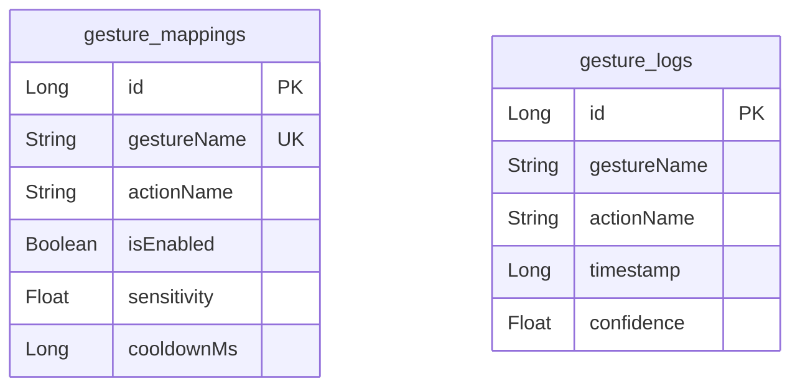

**`gesture_mappings`** (`GestureMappingEntity`)

| Column | Type | Default | Notes |
|---|---|---|---|
| `id` | Long | auto | Primary key |
| `gestureName` | String | | `EyeGesture.name`, unique index |
| `actionName` | String | | `AppAction.name` |
| `isEnabled` | Boolean | `true` | |
| `sensitivity` | Float | `0.5` | |
| `cooldownMs` | Long | `1000` | Per-gesture cooldown |

**`gesture_logs`** (`GestureLogEntity`)

| Column | Type | Notes |
|---|---|---|
| `id` | Long | Auto primary key |
| `gestureName` | String | `EyeGesture.name` |
| `actionName` | String | `AppAction.name` |
| `timestamp` | Long | epoch ms |
| `confidence` | Float | 0–1 |

**DAOs**

| DAO | Method | Query / behaviour |
|---|---|---|
| `GestureMappingDao` | `getAllMappings(): Flow<List>` | `SELECT * FROM gesture_mappings` |
| | `getMappingByGesture(name)` | `... WHERE gestureName = :name LIMIT 1` |
| | `insertMapping`, `insertMappings` | `OnConflictStrategy.REPLACE` |
| | `insertMappingsIfAbsent` | `OnConflictStrategy.IGNORE` (seeding never overwrites user choices) |
| | `replaceAll` | `@Transaction`: delete all, then insert |
| | `updateMapping`, `deleteMapping`, `deleteAllMappings` | |
| `GestureLogDao` | `getRecentLogs(limit): Flow<List>` | `ORDER BY timestamp DESC LIMIT :limit` |
| | `getAllLogs(): Flow<List>` | `ORDER BY timestamp DESC` |
| | `insertLog`, `clearAllLogs`, `deleteOldLogs(olderThan)` | |
| | `observeCountSince(since): Flow<Int>` | `SELECT COUNT(*) ... WHERE timestamp >= :since` |

The repositories (`data/repository`) convert between entities and domain models. They store enum names as strings and silently skip rows whose name no longer matches an enum constant.

**Default mappings** (`GestureMappingRepository.defaultMappings`) are seeded on onboarding with `insertDefaultMappings()`, which keeps existing rows. Reset uses `resetToDefaults()`, which replaces everything:

| Gesture | Action |
|---|---|
| Look Up | Scroll Up |
| Look Down | Scroll Down |
| Look Left | Swipe Left |
| Look Right | Swipe Right |
| Left Wink | Back |
| Right Wink | Tap |
| Both Eyes Blink | Tap |
| Double Wink | Open Notifications |
| Fast Multi-Blink | Lock Screen |
| Eyes Wide Open | Home |

### DataStore — `eye_tracking_prefs`

Defined in `data/datastore/AppPreferences.kt` and exposed as `Flow<DetectionSettings>` plus individual flags.

| Key | Default | Used by |
|---|---|---|
| `is_onboarded` | `false` | Splash routing |
| `is_service_enabled` | `false` | Home, BootReceiver (resume notification) |
| `is_dark_mode` | `false` | MainActivity theme |
| `blink_threshold` | `0.3` | Detector (set by calibration) |
| `wide_open_threshold` | `0.75` | Detector |
| `half_open_threshold` | `0.45` | — |
| `gaze_left_threshold` / `gaze_right_threshold` | `-15` / `15` | Detector (set by calibration) |
| `gaze_up_threshold` / `gaze_down_threshold` | `-10` / `10` | Detector (set by calibration) |
| `fast_blink_count` | `3` | Detector |
| `fast_blink_window_ms` | `1000` | Detector |
| `global_cooldown_ms` | `500` | Detector, GestureAnalyzer |
| `debounce_ms` | `150` | — |
| `is_vibration_enabled` | `true` | ActionDispatcher |
| `is_voice_feedback_enabled` | `false` | ActionDispatcher → VoiceFeedback |
| `is_overlay_enabled` | `true` | EyeTrackingForegroundService → OverlayManager |
| `is_logging_enabled` | `true` | GestureAnalyzer |
| `is_face_pointer_enabled` | `false` | Detector, GestureAnalyzer, FacePointerManager |
| `pointer_speed` | `1.5` | FacePointerManager |
| `pointer_sensitivity` | `3.0` | FacePointerManager |

---

## Design patterns

| Pattern | Where | Purpose |
|---|---|---|
| **MVVM** | `ui/screens/*/*ViewModel.kt` + `*Screen.kt` | `@HiltViewModel` classes expose immutable state through `StateFlow`; composables collect it and send user events back as method calls. |
| **Repository** | `data/repository/GestureMappingRepository.kt`, `GestureLogRepository.kt` | Hides Room behind a domain-model API and handles entity ↔ domain mapping. |
| **Dependency Injection (Hilt)** | `di/DatabaseModule.kt`, `di/DetectionModule.kt`; `@AndroidEntryPoint` on `MainActivity`, both services and `BootReceiver` | Provides singletons (database, DAOs, repositories, preferences, detector) to the UI and the services. |
| **Singleton event bus** | `service/GestureEventBus.kt`, `service/PointerClickBus.kt` | Kotlin `object`s wrapping `MutableSharedFlow`. They decouple the foreground service from the accessibility service, which the system instantiates and Hilt cannot inject across. |
| **Observer (reactive streams)** | `EyeGestureDetector.gestureFlow`, `GestureAnalyzer.actionFlow`, `combine(...)` in `HomeViewModel` | Producers emit on `SharedFlow`/`Flow`; consumers collect them in a lifecycle-aware scope. |
| **State machine (explicit)** | `CalibrationStep` in `ui/screens/calibration/CalibrationViewModel.kt` | An enum-driven wizard. Each step carries its instruction and timing, and is run sequentially in a coroutine. |
| **Pure functional core** | `detection/CalibrationCalculator.kt` | Threshold math with no Android dependencies, unit-tested in isolation. |
| **State machine (implicit)** | `detection/EyeGestureDetector.kt` | Previous-frame data, timing windows and counters model the blink, wink and gaze transitions. |
| **Adapter** | `detection/FaceAnalyzer.kt` | Adapts CameraX `ImageAnalysis.Analyzer` frames to ML Kit `InputImage` and the app's `FaceData`, delivered through a callback. |
| **Facade** | `detection/FrontCameraSession.kt`, `service/VoiceFeedback.kt` | Hide CameraX binding and TextToSpeech lifecycle behind small APIs shared by several callers. |
| **Command / dispatcher** | `service/ActionDispatcher.kt` | Maps each `AppAction` value to a concrete platform operation in a single `when`. |
| **Single-activity navigation** | `MainActivity.kt`, `ui/navigation/AppNavigation.kt` | One activity hosting a Compose `NavHost`. |

---

## Services, permissions and manifest

| Permission | Why |
|---|---|
| `CAMERA` | Front camera for face detection |
| `FOREGROUND_SERVICE`, `FOREGROUND_SERVICE_CAMERA` | Keep detection running in the background |
| `SYSTEM_ALERT_WINDOW` | Overlay indicator and face-pointer cursor |
| `RECEIVE_BOOT_COMPLETED` | Offer to resume tracking after boot |
| `VIBRATE` | Haptic feedback on actions and calibration steps |
| `POST_NOTIFICATIONS` | Service status and the resume prompt (optional, Android 13+) |

Also declared:
- `<uses-feature android:name="android.hardware.camera" android:required="false">` and the same for `camera.front`, so devices without a camera are not filtered out on Play.
- A `<queries>` entry for `android.intent.action.TTS_SERVICE`, needed for TextToSpeech with package visibility (API 30+).

The accessibility service is not a manifest permission. You enable it in system Settings → Accessibility → Downloaded apps → **Eye Gesture Control**.

| Component | Type | Exported | Notes |
|---|---|---|---|
| `MainActivity` | Activity | yes | Launcher |
| `.ResumeTrackingAlias` | activity-alias → `MainActivity` | **no** | Only reachable through the app's own notification PendingIntent; starting tracking from it cannot be triggered by other apps |
| `EyeTrackingForegroundService` | Service | no | `foregroundServiceType="camera"`, `START_STICKY`, notification channel `eye_tracking_channel` with a Stop action. If a STICKY restart is refused the camera, it posts the resume notification and stops |
| `EyeTrackingAccessibilityService` | AccessibilityService | yes | Protected by `BIND_ACCESSIBILITY_SERVICE`; config in `res/xml/accessibility_service_config.xml` (`canPerformGestures`, `canRetrieveWindowContent`) |
| `BootReceiver` | BroadcastReceiver | yes (required for `BOOT_COMPLETED`, a protected system broadcast) | Posts "Eye tracking is paused — tap to resume" if `is_service_enabled` |

**Backup:** `android:allowBackup="false"`. `data_extraction_rules.xml` and `backup_rules.xml` exclude every domain, so gesture history and settings are not included in cloud backup or device transfer.

**Release build:** R8 minification and resource shrinking are enabled. `proguard-rules.pro` strips `Log.v/d/i` calls; warnings and errors are kept.

---

## Tech stack

| Area | Library | Version |
|---|---|---|
| Language | Kotlin | 2.2.10 |
| Build | Android Gradle Plugin (Kotlin DSL, version catalog) | 9.1.1 |
| UI | Jetpack Compose BOM / Material 3 | 2025.05.00 |
| Navigation | Navigation Compose | 2.9.0 |
| DI | Hilt | 2.59.1 |
| Database | Room (KSP) | 2.7.0 |
| Preferences | DataStore Preferences | 1.1.4 |
| Camera | CameraX | 1.5.0 |
| ML | ML Kit Face Detection (bundled model) | 16.1.7 |
| Async | Kotlin Coroutines + Flow | 1.10.2 |

SDK levels: `minSdk 28`, `targetSdk 36`, `compileSdk 36.1`. Java/JVM target 11.

---

## Build and run

```bash
./gradlew assembleDebug        # build
./gradlew installDebug         # install on a connected device
./gradlew testDebugUnitTest    # unit tests (JUnit + MockK)
./gradlew assembleRelease      # minified release build (needs a signing config to install)
```

Unit tests live in `app/src/test`:

| Test | Covers |
|---|---|
| `CalibrationCalculatorTest` | Threshold derivation, clamping, failure cases, outlier handling |
| `GestureMappingRepositoryTest` | Seeding never overwrites; reset is one transactional replace with one row per gesture |
| `GestureLogRepositoryTest` | "Today" uses local midnight, not UTC |
| `EyeGestureTest` | Exactly the four undetected gestures are unsupported; defaults use supported gestures |

First-run setup on the device:

1. Complete onboarding.
2. Grant **Camera** and **Display over other apps**. Optionally allow **Notifications**.
3. Enable the **Eye Gesture Control** accessibility service.
4. Run **Calibration** once.
5. On Home, tap **Start Service**.

Live Preview is useful for checking detection before you rely on the background service.

---

## Known limitations

**Detection**
- Eye Roll, Random Blink, Eye Tracking and Eye Pop are not detected yet. They are hidden from the UI (`isSupported = false`) but kept in the enum so stored rows still resolve.
- `SURPRISE_WIDE` fires whenever the average eye-open probability is above a hard-coded 0.90, and `EYES_WIDE_OPEN` above `wide_open_threshold`. With normally open eyes these can fire repeatedly and use up the global cooldown. Calibration deliberately does not change `wide_open_threshold` until this logic is reworked.
- `half_open_threshold` and `debounce_ms` are stored but not used by the detector.
- While Live Preview is open and the service is running, gestures detected in the preview are dispatched as real actions.

**Data**
- There is no instrumented migration test yet. Migration 1 → 2 was verified manually: on a device with a v1 database, and on a local copy with duplicate rows injected.
